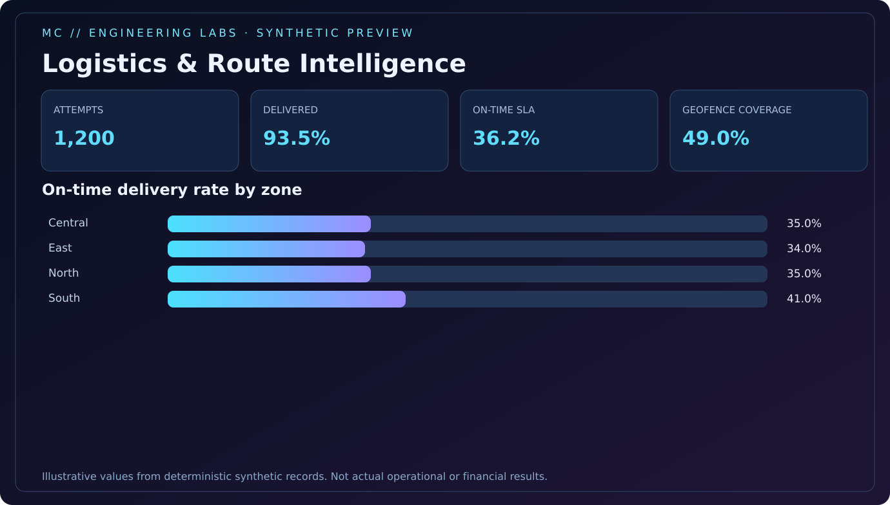

<p align="center"></p>

<p align="center">
  <a href="https://github.com/Dicureck/logistics-route-intelligence/actions/workflows/ci.yml"></a>
  </img>
  </img>
  </img>
</p>

# Logistics & Route Intelligence

**An independent analytics engineering lab for fictional last-mile operations.** Generate deterministic delivery records, measure service-level performance, compare planned vs actual distance, assess simple coordinate-based geofences, and publish an offline HTML KPI dashboard.

> **Not a real client deployment.** All drivers, deliveries, dates, route IDs, coordinates and metrics are generated. This project demonstrates methodology; it makes no performance claims about any business.

## Synthetic dashboard preview



A [self-contained HTML example](examples/synthetic-dashboard.html) is included. The command below regenerates it from seed `2026`.

## Quick start

```bash
python -m venv .venv
# Activate your virtual environment for your operating system.
python -m pip install -e '.[dev]'
python -m pytest -q
python -m logistics_route_intelligence demo --rows 1200 --seed 2026 --out-dir build/demo
```

Open `build/demo/dashboard.html` locally. The generated directory also contains `synthetic_deliveries.csv` and `zone_kpis.csv`; generated files are not committed. For a different simulation, change the seed or row count.

## Architecture

```text
Synthetic generation (seed + schema)
    ↓
Raw deliveries CSV → enrichment → zone KPI aggregation
    ↓                                 ↓
Offline HTML dashboard         Power BI CSV import
```

## Engineering artifacts

| Artifact | What's inside |
|:--|:--|
| `src/logistics_route_intelligence/core.py` | Reproducible generation, Haversine distance and metrics |
| `src/logistics_route_intelligence/report.py` | Standalone HTML dashboard renderer |
| `tests/` | Determinism, referential integrity, SLA policy, geography checks |
| [Metric definitions](docs/metrics.md) | Explicit numerator/denominator contracts |
| [Power BI blueprint](docs/power-bi-blueprint.md) | Suggested model, DAX measures, report layout |
| [Engineering decisions](docs/design-notes.md) | Tradeoffs and scope boundaries |

## Interpretation guardrails

**On-time SLA denominator = all attempts, including unsuccessful deliveries.** A distance ratio is descriptive, not evidence of a causal improvement. Great-circle geofences are not street-network routes. Review [metric contracts](docs/metrics.md) before using the examples.

## Portfolio context

Designed by **Melissa Castro** as an original public demonstration of operational analytics methods. Not sourced from, representative of, or endorsed by any employer or client. MIT licensed.
